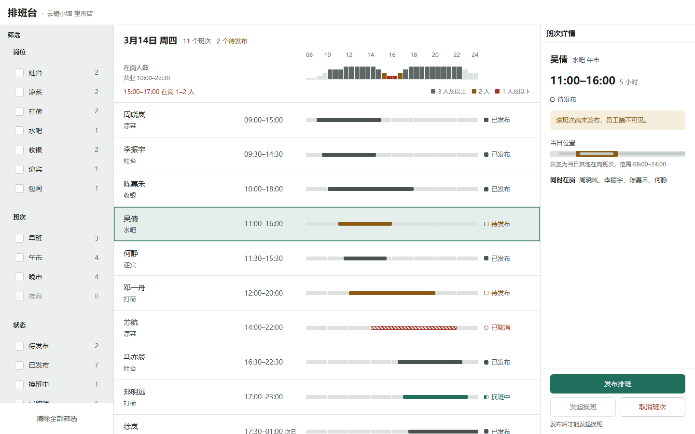
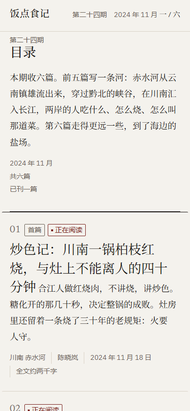
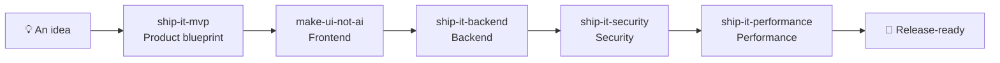

[中文](./README.md) · **English**

# 🚢 Ship-It Skills

A composable skill suite for AI coding agents (Claude Code, Codex, Reasonix, and others) that covers the full software delivery chain: **Product → Frontend → Backend → Security → Performance**.

Each skill is a self-contained `SKILL.md` (YAML frontmatter + instructions) following the Agent Skills standard. Skills can be used individually or chained into a complete delivery pipeline — from a vague idea, to a product blueprint with acceptance criteria, to a frontend with a real product identity, to a production-grade backend, then through security hardening and performance verification until it is release-ready.


## Why Ship-It?

Most agents jump straight into writing code when handed a request — the result is often "a big pile of working code" rather than "software that can ship."

Ship-It breaks development into stages that each have **acceptance criteria**, a **definition of done**, and a **deliverable**, so the agent works like a small team:

1. First decide **what to build** (an MVP blueprint, not a feature list)
2. Then make it **look like a product** (a frontend with identity, not AI-template flavor)
3. Then implement **how it runs** (production-grade backend vertical slices, not disconnected layers)
4. Then complete **security hardening** (evidence-backed risk and verified fixes)
5. Finally complete **performance verification** (measure first, optimize second, prevent regressions with budgets)

Each stage's output is the next stage's input, with evidence at every step.

## Skill Overview

| Skill | One-liner | When to use | Docs |
| --- | --- | --- | --- |
| [ship-it-mvp](#ship-it-mvp) | Turn a rough idea into a build-ready MVP blueprint | Have a product idea, need a PRD / scope / build plan | [SKILL.md](./ship-it-mvp/SKILL.md) |
| [make-ui-not-ai](#make-ui-not-ai) | Build frontends with a real product identity, not an AI-template look | Build / redesign / review a UI, or the UI "looks AI-generated" | [SKILL.md](./make-ui-not-ai/SKILL.md) |
| [ship-it-backend](#ship-it-backend) | Turn requirements into production-minded, verified backend vertical slices | Add APIs, database-backed features, webhooks, authorization rules, backend integrations | [SKILL.md](./ship-it-backend/SKILL.md) |
| [ship-it-security](#ship-it-security) | Find and fix release-blocking risk with a threat-driven security workflow | Security reviews, access control, tenant isolation, sessions, secrets, dependencies, uploads, webhooks, release hardening | [SKILL.md](./ship-it-security/SKILL.md) |
| [ship-it-performance](#ship-it-performance) | Locate bottlenecks from reproducible baselines and verify the gain | Slow pages or APIs, expensive queries, Core Web Vitals, throughput, memory, regressions, performance budgets | [SKILL.md](./ship-it-performance/SKILL.md) |

### ship-it-mvp — Product

Turns "build me an X" into a **decision-ready MVP blueprint**: a focused product brief, scope classification (Now / Next / Not now), the core user flow, item-by-item acceptance criteria, a technical shape, and a dependency-ordered implementation plan with the cheapest validation for the biggest risk. Optimize for a small first release that proves one valuable user outcome — not feature completeness.

- Optional generator: `scripts/make_mvp_blueprint.py` — feed it a JSON brief and get a deterministic Markdown blueprint.
- Example trigger: "Help me make an MVP for a 'what should I eat tonight' app"

### make-ui-not-ai — Frontend

Build, redesign, or review frontend interfaces so they **have a clear product identity** instead of coming from a generic AI template. The core is a **ban list that grows**: telling a model to "avoid the AI look" merely swaps one default for another, so the skill names the specific patterns to refuse (warm cream plus serif display plus terracotta, the SaaS rounded-card kit, `01/02/03` numbering, pill buttons, rainbow gradients…) and extends the list after inspecting the first render. It ships a **canonical values table** (transition durations, `scale(0.96)` press feedback, the concentric-radius formula, 44px hit areas, focus rings, icon stroke weights, tabular-nums) and separates *functionally verified* from *visually verified* using independent critique and real screenshots.

- Example trigger: "Make this page feel like a real product, not an AI template"
- Also for polish work: "this button feels wrong" / "check the hierarchy and spacing"
- See it in action: [skill-showcase](skill-showcase/README.md) — four deliberately divergent pages, desktop and mobile renders, and the defects that only surfaced by looking at real images and measuring real viewports

<table>
<tr>
<td width="50%"><br><sub>Operational console · 1440×900 · one shared time axis</sub></td>
<td width="50%"><br><sub>Editorial page · a real 390×844 viewport</sub></td>
</tr>
</table>

Both images were **rendered in a browser at the stated viewport and then actually looked at** — they are not mockups.

### ship-it-backend — Backend

Delivers one backend capability **end to end**: define the contract first (actor, inputs, success, invariants, failures, state change), then walk the full vertical slice — schema and migrations, boundary validation, authentication and authorization, business rules, persistence, stable errors, integrity controls (transactions / idempotency / concurrency), focused tests. Preserve the repository's stack and conventions; no speculative abstractions. The definition of done is explicit: entry point wired, invariants enforced server-side, valid migration that preserves data, stable non-leaking failure responses, passing tests, and an **exact integration contract** handed to the frontend.

- Example trigger: "Implement the backend for this feature, including database and tests"

### ship-it-security — Security

Applies **threat-driven security hardening** to critical product paths: identify assets, actors, entry points, trust boundaries, and security invariants, then validate real risks by reachability and impact. Every material finding requires a concrete path, attacker prerequisites, redacted evidence, impact, a root-cause fix, and a regression test. It covers relevant identity, authorization, tenant isolation, injection, sessions, CSRF, XSS, privacy, upload, webhook, supply-chain, and configuration surfaces, ending with an explicit release gate rather than treating scanner volume as security quality.

- Example trigger: "Review this project before release, fix high-risk security issues, and add tests"

### ship-it-performance — Performance

Completes **measurable performance optimization** around one important journey: define a representative workload, primary metric, and guardrails; establish a reproducible baseline; locate the dominant bottleneck with traces, profiles, query plans, or network waterfalls; change only the proven hot path; and compare before and after under equivalent conditions. It covers frontend rendering and bundles, networks, APIs, databases, caches, and runtimes while preserving correctness, security, accessibility, and data freshness, then protects the gain with a budget, benchmark, or monitoring recommendation.

- Example trigger: "This page and API are slow; find the bottleneck, optimize it, and show me before-and-after data"

## Chaining the Skills



Typical scenario — "I want to build a 'what should I eat tonight' app":

1. **ship-it-mvp**: produces the MVP blueprint, scoping the first release (recommend a restaurant, today's menu, a decision countdown) with acceptance criteria;
2. **make-ui-not-ai**: builds a frontend with a real product identity from the blueprint (the [`skill-showcase/`](./skill-showcase/) directory in this repo is a demo app produced by these skills);
3. **ship-it-backend**: implements the backend vertical slice — restaurant / menu APIs, database migrations, business rules and tests, plus an integration contract for the frontend;
4. **ship-it-security**: models threats around accounts, restaurant data, administrative actions, and API boundaries, fixes release blockers, and adds security regression tests;
5. **ship-it-performance**: measures the first viewport, core interaction, API, and query performance, removes the dominant bottleneck, and establishes regression budgets until the product is release-ready.

## Installation

### Option 1: Let your agent install it (recommended)

Send this to your agent (swap the path for the skill you want):

> Please install this skill: https://github.com/nanfei892/ship-it-skills/tree/master/make-ui-not-ai

If your environment doesn't support automatic skill installation, download the corresponding `SKILL.md` into your agent's skills directory and use it as a rules file (same instructions, loaded manually).

### Option 2: Manual clone

```bash
git clone git@github.com:nanfei892/ship-it-skills.git
```

Then copy or symlink the skill directories you need into your agent's skills directory, e.g.:

- Claude Code: `~/.claude/skills/`
- Codex: `~/.codex/skills/`

### How skills trigger

Skills trigger **semantically**: when your agent sees a request that matches a skill's `SKILL.md` description, it loads that skill automatically — no special prefix needed. Most environments also support manual invocation (e.g. `/ship-it-mvp` in Reasonix).

## Repository Layout

```
.
├── ship-it-mvp/          # Product: MVP blueprint (optional generator in scripts/)
├── make-ui-not-ai/       # Frontend: UI with product identity
├── ship-it-backend/      # Backend: production-grade vertical slices
├── ship-it-security/     # Security: threat-driven hardening and release gates
├── ship-it-performance/  # Performance: baselines, bottleneck fixes, regression budgets
├── skill-showcase/       # Demo app produced by these skills ("饭点" example)
├── README.md             # 中文说明 (Chinese)
├── README.en.md          # English version
└── LICENSE               # MIT License
```

## Roadmap

- 📦 **One-click plugin packaging** (planned): publish the skills and pipeline orchestration as one plugin — install everything with one command, use stages independently, or run the full delivery chain.

## Disclaimer

The skills in this repository are provided for educational purposes and project acceleration. Actual behavior varies by agent version and runtime environment; always test thoroughly in your own environment before relying on them for production or payment-critical paths.

## Contributing

PRs welcome. Conventions:

- Each skill is **self-contained** in its own directory and follows the `SKILL.md` frontmatter (`name` + `description`) spec;
- Keep the collaboration model between skills unchanged (one skill's output is the next skill's input);
- When adding a skill, update the skill overview table and the Roadmap in this README.

## License

[MIT](./LICENSE)
