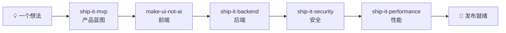

**中文** · [English](./README.en.md)

# 🚢 Ship-It Skills

一套面向 AI 编码代理（Claude Code、Codex、Reasonix 等）的**可组合技能集**，覆盖软件交付的完整链路：**产品 → 前端 → 后端 → 安全 → 性能**。

每个技能都是自包含的 `SKILL.md`（YAML frontmatter + 指令），遵循 Agent Skills 标准。可以单独使用，也可以串联成一条完整的开发流水线——从一句模糊的想法，到有验收标准的产品蓝图、有产品身份的前端、生产级的后端，再经过安全加固与性能验证，最终达到发布就绪。


## 为什么用 Ship-It？

大多数 agent 拿到需求会直接开始写代码——结果常常是"一大坨能跑的代码"，而不是"一个能发布的软件"。

Ship-It 把开发拆成有**验收标准**、有**完成定义**、有**交付物**的环节，让 agent 像一个小团队一样工作：

1. 先想清楚**做什么**（MVP 蓝图，而不是功能清单）
2. 再做出来**像什么**（有产品身份的前端，而不是 AI 模板味）
3. 然后实现**怎么跑**（生产级的后端垂直切片，而不是孤立的代码层）
4. 接着完成**安全加固**（有证据的风险与可验证的修复）
5. 最后完成**性能验证**（先测量、再优化、用预算防回归）

每个环节的产出都是下一个环节的输入，环环有据可查。

## 技能总览

| 技能 | 一句话 | 触发时机 | 文档 |
| --- | --- | --- | --- |
| [ship-it-mvp](#ship-it-mvp) | 把粗略想法变成可构建的 MVP 蓝图 | 有产品想法、需要 PRD / 范围 / 实现计划 | [SKILL.md](./ship-it-mvp/SKILL.md) |
| [make-ui-not-ai](#make-ui-not-ai) | 构建有产品身份的前端界面，去除 AI 模板味 | 做 / 改 / 审前端界面，或界面"一看就是 AI 生成的" | [SKILL.md](./make-ui-not-ai/SKILL.md) |
| [ship-it-backend](#ship-it-backend) | 把需求变成生产级、验证过的后端垂直切片 | 加 API、数据库功能、webhook、权限规则、后端集成 | [SKILL.md](./ship-it-backend/SKILL.md) |
| [ship-it-security](#ship-it-security) | 用威胁模型发现并修复真正阻碍发布的安全风险 | 安全审查、权限与租户隔离、会话、密钥、依赖、上传、webhook、发布前加固 | [SKILL.md](./ship-it-security/SKILL.md) |
| [ship-it-performance](#ship-it-performance) | 用可复现基线定位瓶颈并验证性能提升 | 页面或接口慢、查询昂贵、Core Web Vitals、吞吐、内存、性能回归与预算 | [SKILL.md](./ship-it-performance/SKILL.md) |

### ship-it-mvp — 产品

把"帮我做一个 X"的粗略想法整理成**可直接开工的 MVP 蓝图**：一份聚焦的产品简报、范围划分（Now / Next / Not now）、核心用户流程、逐条验收标准、技术形状，以及按依赖排序的实现计划和最便宜的验证方式。只做证明第一个用户价值的最小版本，不做功能大而全。

- 附带可选生成器：`scripts/make_mvp_blueprint.py`，输入 JSON 简报即可输出确定性的 Markdown 蓝图。
- 示例触发："帮我做一个'今晚吃什么'的小程序的 MVP"

### make-ui-not-ai — 前端

构建、重设计或审查前端界面，让界面**有明确的产品身份**，而不是来自通用 AI 模板。核心是一份**会生长的禁用清单**——因为泛泛地说"避免 AI 味"只会换来另一种默认风格，有效做法是点名禁用具体模式（暖奶油底 + 衬线标题 + 陶土色的"编辑风"、SaaS 圆角卡片墙、`01/02/03` 编号、胶囊按钮、彩虹渐变……），第一版渲染后再把新出现的老套加进清单。技能自带一张**精确数值表**（过渡时长、按压 `scale(0.96)`、同心圆角公式、44px 命中区、焦点环、字重与图标描边、tabular-nums），并用**独立视觉评审 + 真实截图核验**把"功能正确"和"看起来对"分开验证。

- 示例触发："把这个页面改得像正经产品，别像 AI 模板"
- 也适用于细节打磨："这个按钮交互手感不对" / "检查一下层级和间距"

### ship-it-backend — 后端

把一个后端能力**端到端交付**：先定契约（角色、输入、成功、不变量、失败、状态变更），再走完整垂直切片——schema 与迁移、边界校验、认证授权、业务规则、持久化、稳定错误、完整性控制（事务 / 幂等 / 并发）、聚焦测试。遵循仓库既有技术栈与约定，不引入投机性抽象。完成定义明确：入口可达、不变量在服务端执行、迁移有效且保留数据、失败用稳定不泄密的响应、测试通过，最后给前端一份**精确的对接契约**。

- 示例触发："给这个功能把后端接口做了，包括数据库和测试"

### ship-it-security — 安全

对产品关键路径做**威胁驱动的安全加固**：先识别资产、角色、入口、信任边界与安全不变量，再按可达性和影响验证真实风险。每个重要发现都必须有代码路径、攻击前提、脱敏证据、影响、根因修复和回归测试。技能覆盖身份与权限、租户隔离、注入、会话、CSRF、XSS、隐私、上传、webhook、供应链与配置等实际存在的攻击面，并给出明确的发布门槛，不用扫描器数量冒充安全质量。

- 示例触发："发布前把这个项目做一次安全审查，修掉高风险问题并加测试"

### ship-it-performance — 性能

围绕一个重要用户旅程完成**可测量的性能优化**：定义代表性负载、主指标和守护指标，建立可复现基线，用 trace、profile、查询计划或网络瀑布定位主瓶颈，只优化被证据证明的热路径，再在同等条件下比较前后结果。覆盖前端渲染与包体、网络、API、数据库、缓存和运行时，并用预算、基准测试或监控建议保护收益，同时保证正确性、安全、无障碍和数据新鲜度不倒退。

- 示例触发："这个页面和接口都很慢，先找到瓶颈，再优化并给我前后数据"

## 如何串联使用



典型场景——"我想做一个'今晚吃什么'的小程序"：

1. **ship-it-mvp**：产出 MVP 蓝图，圈定第一版范围（推荐餐厅、今日菜单、决策倒计时）与验收标准；
2. **make-ui-not-ai**：按蓝图做出有产品身份的前端界面（本仓库 [`skill-showcase/`](./skill-showcase/) 就是这套技能产出的演示应用）；
3. **ship-it-backend**：实现后端垂直切片——餐厅 / 菜单 API、数据库迁移、业务规则与测试，并给前端一份对接契约；
4. **ship-it-security**：围绕账号、餐厅数据、管理操作和接口边界建立威胁模型，修复发布阻断项并加入安全回归测试；
5. **ship-it-performance**：测量首屏、核心交互、API 与查询性能，移除主瓶颈并建立回归预算，达到发布就绪。

## 安装

### 方式一：让 agent 自己装（推荐）

把下面这句话发给你的 agent（把路径换成想装的技能）：

> 请安装这个技能：https://github.com/nanfei892/ship-it-skills/tree/master/make-ui-not-ai

若你的环境不支持自动安装技能，直接把对应目录下的 `SKILL.md` 下载到 agent 的技能目录，作为规则文件使用即可（同一套指令，手动加载）。

### 方式二：手动 clone

```bash
git clone git@github.com:nanfei892/ship-it-skills.git
```

然后把需要的技能目录复制或软链接到你的 agent 技能目录，例如：

- Claude Code：`~/.claude/skills/`
- Codex：`~/.codex/skills/`

### 触发方式

技能按**语义自动触发**：你的 agent 读到与 `SKILL.md` description 匹配的需求时，会自动加载对应技能，无需特殊前缀。多数环境也支持手动指定（例如 Reasonix 的 `/ship-it-mvp`）。

## 仓库结构

```
.
├── ship-it-mvp/          # 产品：MVP 蓝图（含可选生成器 scripts/）
├── make-ui-not-ai/       # 前端：有产品身份的 UI
├── ship-it-backend/      # 后端：生产级垂直切片
├── ship-it-security/     # 安全：威胁驱动的加固与发布门槛
├── ship-it-performance/  # 性能：基线、瓶颈优化与回归预算
├── skill-showcase/       # 本套技能产出的演示应用（"饭点"示例）
├── README.md             # 中文说明
├── README.en.md          # English version
└── LICENSE               # MIT License
```

## Roadmap

- 📦 **插件一键打包**（规划中）：将整套技能与流水线编排发布为插件，一条命令装齐，既可按阶段单独使用，也可一键运行完整交付链路。

## 免责声明

本仓库技能用于教学与项目加速。实际行为因 agent 版本与运行环境而异；在用于生产环境、支付等关键路径之前，请务必在你的环境中充分测试。

## Contributing

欢迎 PR。约定：

- 每个技能**自包含**在一个目录中，遵循 `SKILL.md` frontmatter（`name` + `description`）规范；
- 改动时保持技能之间的协作方式不变（前一技能的产出是后一技能的输入）；
- 新增技能请同步更新本 README 的技能总览表与 Roadmap。

## License

[MIT](./LICENSE)
