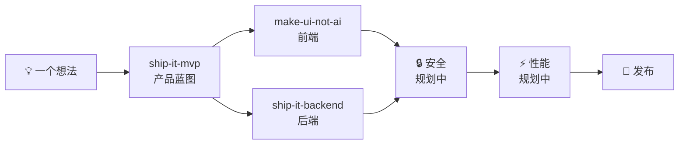

**中文** · [English](./README.en.md)

# 🚢 Ship-It Skills

一套面向 AI 编码代理（Claude Code、Codex、Reasonix 等）的**可组合技能集**，覆盖软件交付的完整链路：**产品 → 前端 → 后端 → 安全 → 性能**。

每个技能都是自包含的 `SKILL.md`（YAML frontmatter + 指令），遵循 Agent Skills 标准。可以单独使用，也可以串联成一条完整的开发流水线——从一句模糊的想法，到有验收标准的产品蓝图、有产品身份的前端、生产级的后端，最终发布上线。


## 为什么用 Ship-It？

大多数 agent 拿到需求会直接开始写代码——结果常常是"一大坨能跑的代码"，而不是"一个能发布的软件"。

Ship-It 把开发拆成有**验收标准**、有**完成定义**、有**交付物**的环节，让 agent 像一个小团队一样工作：

1. 先想清楚**做什么**（MVP 蓝图，而不是功能清单）
2. 再做出来**像什么**（有产品身份的前端，而不是 AI 模板味）
3. 然后实现**怎么跑**（生产级的后端垂直切片，而不是孤立的代码层）
4. 最后补上**安全与性能**（规划中）

每个环节的产出都是下一个环节的输入，环环有据可查。

## 技能总览

| 技能 | 一句话 | 触发时机 | 文档 |
| --- | --- | --- | --- |
| [ship-it-mvp](#ship-it-mvp) | 把粗略想法变成可构建的 MVP 蓝图 | 有产品想法、需要 PRD / 范围 / 实现计划 | [SKILL.md](./ship-it-mvp/SKILL.md) |
| [make-ui-not-ai](#make-ui-not-ai) | 构建有产品身份的前端界面，去除 AI 模板味 | 做 / 改 / 审前端界面，或界面"一看就是 AI 生成的" | [SKILL.md](./make-ui-not-ai/SKILL.md) |
| [ship-it-backend](#ship-it-backend) | 把需求变成生产级、验证过的后端垂直切片 | 加 API、数据库功能、webhook、权限规则、后端集成 | [SKILL.md](./ship-it-backend/SKILL.md) |

### ship-it-mvp — 产品

把"帮我做一个 X"的粗略想法整理成**可直接开工的 MVP 蓝图**：一份聚焦的产品简报、范围划分（Now / Next / Not now）、核心用户流程、逐条验收标准、技术形状，以及按依赖排序的实现计划和最便宜的验证方式。只做证明第一个用户价值的最小版本，不做功能大而全。

- 附带可选生成器：`scripts/make_mvp_blueprint.py`，输入 JSON 简报即可输出确定性的 Markdown 蓝图。
- 示例触发："帮我做一个'今晚吃什么'的小程序的 MVP"

### make-ui-not-ai — 前端

构建、重设计或审查前端界面，让界面**有明确的产品身份**，而不是来自通用 AI 模板。先读产品再定设计契约（产品信号、信息形态、视觉前提、字体 / 色彩 / 几何节奏、标志性决策），实现真实可用的界面，再做一遍"去模板痕迹"的刻意检查（三栏数据条、bento 卡片墙、滥用渐变玻璃、千篇一律的间距动画……），在真实 viewport 下验证，最后过 7 项完成门槛（具体 / 有用 / 完整 / 连贯 / 响应式 / 无障碍 / 已验证）。

- 示例触发："把这个页面改得像正经产品，别像 AI 模板"

### ship-it-backend — 后端

把一个后端能力**端到端交付**：先定契约（角色、输入、成功、不变量、失败、状态变更），再走完整垂直切片——schema 与迁移、边界校验、认证授权、业务规则、持久化、稳定错误、完整性控制（事务 / 幂等 / 并发）、聚焦测试。遵循仓库既有技术栈与约定，不引入投机性抽象。完成定义明确：入口可达、不变量在服务端执行、迁移有效且保留数据、失败用稳定不泄密的响应、测试通过，最后给前端一份**精确的对接契约**。

- 示例触发："给这个功能把后端接口做了，包括数据库和测试"

## 如何串联使用



典型场景——"我想做一个'今晚吃什么'的小程序"：

1. **ship-it-mvp**：产出 MVP 蓝图，圈定第一版范围（推荐餐厅、今日菜单、决策倒计时）与验收标准；
2. **make-ui-not-ai**：按蓝图做出有产品身份的前端界面（本仓库 [`skill-showcase/`](./skill-showcase/) 就是这套技能产出的演示应用）；
3. **ship-it-backend**：实现后端垂直切片——餐厅 / 菜单 API、数据库迁移、业务规则与测试，并给前端一份对接契约；
4. 之后依次接入规划中的安全与性能技能，直到发布。

## 安装

### 方式一：让 agent 自己装（推荐）

把下面这句话发给你的 agent（把路径换成想装的技能）：

> 请安装这个技能：https://github.com/nanfei892/my-skill/tree/main/ship-it-mvp

若你的环境不支持自动安装技能，直接把对应目录下的 `SKILL.md` 下载到 agent 的技能目录，作为规则文件使用即可（同一套指令，手动加载）。

### 方式二：手动 clone

```bash
git clone git@github.com:nanfei892/my-skill.git
```

然后把需要的技能目录复制或软链接到你的 agent 技能目录，例如：

- Claude Code：`~/.claude/skills/`
- Codex：`~/.codex/skills/`

### 触发方式

技能按**语义自动触发**：你的 agent 读到与 `SKILL.md` description 匹配的需求时，会自动加载对应技能，无需特殊前缀。多数环境也支持手动指定（例如 Reasonix 的 `/ship-it-mvp`）。

## 仓库结构

```
.
├── ship-it-mvp/          # 产品：MVP 蓝图（含可选生成器 scripts/）
├── make-ui-not-ai/       # 前端：有产品身份的 UI
├── ship-it-backend/      # 后端：生产级垂直切片
├── skill-showcase/       # 本套技能产出的演示应用（"饭点"示例）
├── README.md             # 中文说明
├── README.en.md          # English version
└── LICENSE               # MIT License
```

## Roadmap

- 🔒 **安全技能**（规划中）：面向交付链路的轻量安全加固与审查——`ship-it-backend` 的定位是"不展开独立深度安全审计"，安全技能将补上这一环；
- ⚡ **性能技能**（规划中）：接口与前端性能基线、瓶颈定位与优化；
- 📦 **插件一键打包**（规划中）：将整套技能发布为插件，一条命令装齐，按项目需求按需启用。

## 免责声明

本仓库技能用于教学与项目加速。实际行为因 agent 版本与运行环境而异；在用于生产环境、支付等关键路径之前，请务必在你的环境中充分测试。

## Contributing

欢迎 PR。约定：

- 每个技能**自包含**在一个目录中，遵循 `SKILL.md` frontmatter（`name` + `description`）规范；
- 改动时保持技能之间的协作方式不变（前一技能的产出是后一技能的输入）；
- 新增技能请同步更新本 README 的技能总览表与 Roadmap。

## License

[MIT](./LICENSE)
